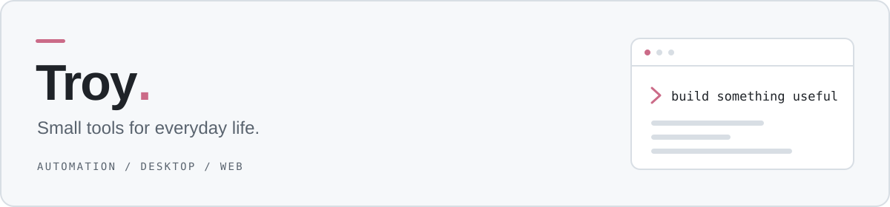

<picture>
  <source media="(prefers-color-scheme: dark)" srcset="./assets/header-dark.svg">
  <source media="(prefers-color-scheme: light)" srcset="./assets/header-light.svg">
  
</picture>

### 你好，我是 Troy 👋

把日常需求，做成顺手的小工具。

这里记录我的自动化工具、桌面应用和自用配置。从 Cloudflare 上的定时任务，到 F1 比赛中的无线电翻译，围绕自己会用到的场景动手实践。

**[浏览项目](https://github.com/Trovoy?tab=repositories)** · **[个人博客](https://lisalove.me)**

### 近期项目

| 项目 | 做什么 | 技术 |
| :--- | :--- | :--- |
| **[每日 · Weibo Check-in](https://github.com/Trovoy/Weibo_Checkin)** | 个人微博超话签到工具，支持扫码登录、等级读取与定时签到，可自行部署。 | TypeScript · Cloudflare Workers · Durable Objects |
| **[F1 Radio Translator](https://github.com/Trovoy/f1-radio-translator)** | 为 MultiViewer 无线电转录窗口提供英中双语翻译，使用本地 OCR 识别字幕。 | PowerShell · C# / WPF · Python |

### 技术与实践

`TypeScript` `JavaScript` `Python` `PowerShell` `C#`

- **自动化** — 把重复操作整理成脚本与定时任务。
- **无服务器应用** — 使用 Cloudflare Workers 与 Durable Objects 实现服务和状态管理。
- **桌面工具** — 结合 WPF、本地 OCR 与翻译服务，解决具体使用场景中的问题。

  
早期项目与自用配置

- [Troy](https://github.com/Trovoy/Troy) — Loon / Surge 自用配置、规则与脚本整理，已暂停维护。
- [Troy's ruleset](https://github.com/Trovoy/Troy-s-ruleset) — 按自用需求整理的规则集，已停止维护。

### 贡献足迹

<picture>
  <source media="(prefers-color-scheme: dark)" srcset="./assets/github-snake-dark.svg">
  <source media="(prefers-color-scheme: light)" srcset="./assets/github-snake.svg">
  
</picture>

---

代码之外：F1 · BLACKPINK 🖤🩷
